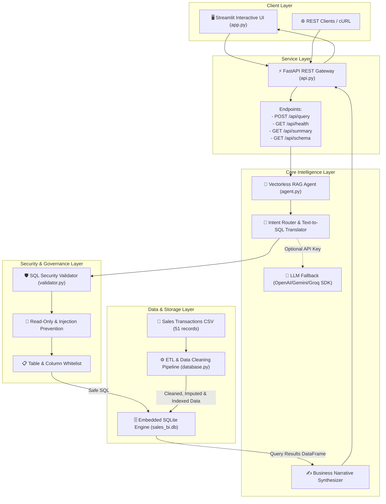
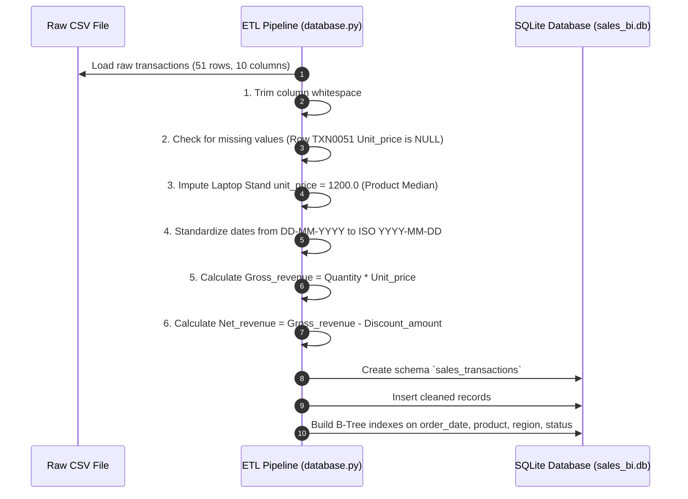
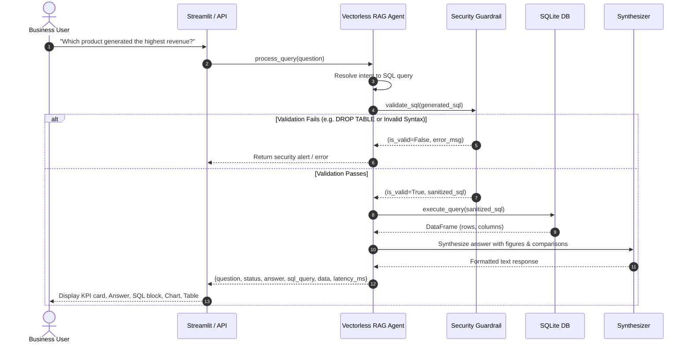

# Architecture & Design Document: Mini AI Business Intelligence Assistant

This document details the architectural decisions, component design, data flow, security model, and interview-aligned concepts implemented in the **Mini AI Business Intelligence Assistant**.

---

## 1. Architectural Paradigm: Vectorless RAG

### Traditional RAG vs. Vectorless RAG for Structured Data

| Dimension | Traditional Vector RAG (Embeddings + Vector DB) | Vectorless RAG (Schema + Text-to-SQL) [Implemented] |
| :--- | :--- | :--- |
| **Core Storage** | Vector Database (Chroma, Pinecone, FAISS) storing document embeddings. | Relational Database (SQLite) storing structured transactional records. |
| **Retrieval Mechanism** | Cosine similarity / Semantic distance search across text chunks. | Deterministic relational query execution (`SELECT`, `GROUP BY`, `SUM`, `WHERE`). |
| **Aggregation Capability** | **Extremely Poor**: Cannot compute mathematical sums, averages, or medians over hundreds of rows without hallucinations. | **Exact & Verifiable**: Computes mathematical aggregations deterministically in milliseconds. |
| **Hallucination Risk** | High for numeric calculations and dates. | Zero arithmetic hallucination (arithmetic is delegated to SQLite). |
| **Explainability** | Black-box embedding scores. | Full transparency via inspectable, human-readable SQL queries. |
| **Safety & Control** | Hard to restrict unauthorized numeric aggregation. | Strict AST and keyword guardrails enforce read-only execution. |

---

## 2. End-to-End Component Architecture

---

## 3. Data Ingestion & ETL Flow

---

## 4. Query Execution Lifecycle

---

## 5. Security & Safety Architecture

To satisfy strict enterprise evaluation criteria, the security validator enforces the following controls:

1. **Strict Read-Only Enforcement**:
   - Queries must strictly begin with `SELECT` or `WITH`.
   - Modifying and administrative statements (`INSERT`, `UPDATE`, `DELETE`, `DROP`, `ALTER`, `TRUNCATE`, `CREATE`, `REPLACE`, `EXEC`, `PRAGMA`, `ATTACH`, `DETACH`) are blocked using regular expressions.
2. **Multi-Statement Injection Prevention**:
   - Chained SQL queries using `;` (e.g. `SELECT 1; DROP TABLE sales;`) are rejected before reaching the SQLite cursor.
3. **Table & Schema Whitelisting**:
   - Queries are checked against `ALLOWED_TABLES = {"sales_transactions"}`. Access to system tables (`sqlite_master`, `sqlite_temp_master`) is blocked.
4. **Out-of-Scope Safeguards**:
   - Queries unrelated to sales metrics (e.g., weather, executive salaries, trivia) trigger an immediate, graceful `unsupported` response rather than executing hallucinated queries.

---

## 6. Technical Stack Summary

* **Language**: Python 3.10
* **Storage & Relational Engine**: SQLite 3 (zero external dependencies, ACID compliant, embedded)
* **Data Processing**: Pandas 2.3, NumPy
* **API Framework**: FastAPI 0.162 + Uvicorn + Pydantic v2
* **Frontend**: Streamlit 1.55 + Altair Interactive Charts
* **Test Framework**: Pytest 9.2
