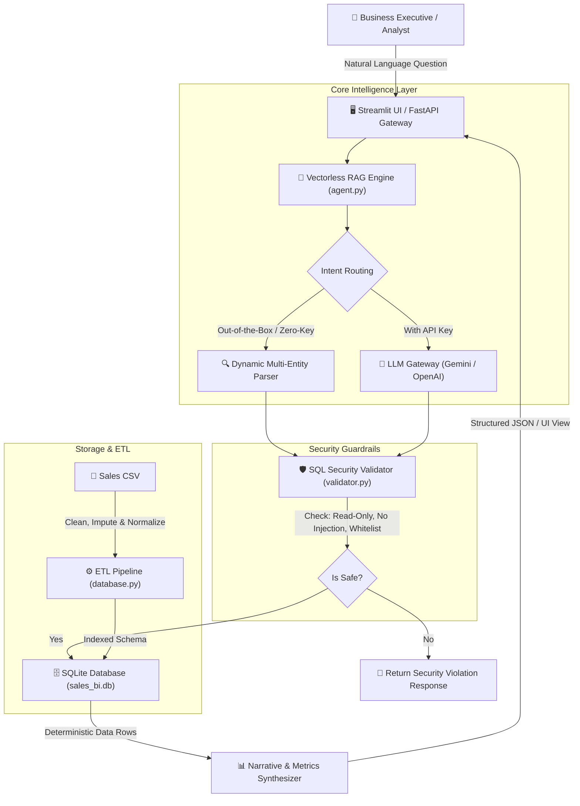

# Mini AI Business Intelligence Assistant (Vectorless RAG)

A production-grade, test-driven **Mini AI Business Intelligence Assistant** built for the **RSG Research Graduate Engineer Trainee (GET) Selection Challenge** (Training & Placement Office, RGUKT-Basar).

The system enables business executives and analysts to query sales transactions using natural language and receive **deterministic, SQL-backed insights** with supporting figures, interactive visualizations, and strict security guardrails.

---

## 🌟 Executive Summary & Core Architectural Highlights

| Pillar | Implementation Highlights |
| :--- | :--- |
| **Architectural Pattern** | **Vectorless RAG (Text-to-SQL + Relational Engine)**: Eliminates arithmetic hallucinations common in vector similarity lookups by delegating all aggregations directly to SQLite. |
| **Hybrid AI Engine** | **Dual-Engine Architecture**: <br>1. *Local Semantic Entity & Intent Parser*: Works 100% out of the box with zero external keys, parsing products, regions, categories, channels, months, and metrics.<br>2. *Direct LLM Gateway*: Pluggable support for **Google Gemini (`gemini-1.5-flash`)** and **OpenAI (`gpt-4o-mini`)** for arbitrary open-ended queries. |
| **Data Hygiene & ETL** | Automatic imputation of missing unit price on `TXN0051` (Laptop Stand $\rightarrow$ ₹1,200), ISO-8601 date standardizing (`YYYY-MM-DD`), and strict exclusion of returned orders (`status = 'Completed'`). |
| **Security & Guardrails** | Multi-layer AST and regex validation: strictly enforces read-only `SELECT`/`WITH` queries, blocks destructive statements (`DROP`, `DELETE`, `UPDATE`), and prevents multi-statement SQL injection attacks. |
| **Full-Stack Delivery** | Complete system containing an embedded **SQLite** database, **FastAPI** backend REST microservice, **Streamlit** interactive dashboard, and a **Pytest** automated test suite (17/17 tests passing). |

---

## 📋 Compliance with Assessment Requirements

### 1. Data Management
* **Data Storage**: Ingests `ai_bi_assistant_sales_data - GET.csv` into an ACID-compliant embedded SQLite database (`sales_bi.db`).
* **Anomalies Handled**:
  * Missing `Unit_price` on `TXN0051` (Laptop Stand) is automatically imputed to ₹1,200.0 using product median.
  * Dates in `DD-MM-YYYY` format are converted to ISO `YYYY-MM-DD` so SQLite `strftime()` functions operate natively.
  * Realized net revenue accounts for returned orders by filtering `status = 'Completed'`.
* **Indexing**: B-Tree indexes created on `order_date`, `product`, `region`, and `status`.

### 2. Backend API
* Built with **FastAPI** and **Pydantic v2**:
  * `POST /api/query`: Accepts natural language question, processes via Vectorless RAG, and returns structured JSON (answer, executed SQL, raw data rows, status, latency).
  * `GET /api/health`: Health status and database row count.
  * `GET /api/summary`: Top-level executive KPIs.
  * `GET /api/schema`: Database schema and business rules.

### 3. Analytics (Deterministic Calculations)
* Computes mathematical results via deterministic SQLite relational queries rather than LLM text approximations.
* Returns verified figures: gross revenue, total discounts, net revenue, units sold, order counts, and percentages.

### 4. AI Integration & Security Guardrails
* **Query Validation**: Every query is inspected by `validator.py` before execution.
* **Destructive Command Defense**: Rejects `DROP`, `DELETE`, `UPDATE`, `INSERT`, `ALTER`, `TRUNCATE`, `EXEC`, `PRAGMA`.
* **Hallucination Prevention**:
  * Zero LLM arithmetic (math is executed by SQLite).
  * Out-of-scope question detection (gracefully rejects non-sales questions like weather or company gossip).
  * SQL transparency (displays the generated SQL and raw table alongside the answer).

### 5. User Interface
* **Streamlit Dashboard** featuring:
  * Executive KPI summary cards (Total Revenue, Completed Orders, Top Product, Peak Month).
  * 1-click preset buttons for the 5 challenge benchmark questions.
  * Free-text question input box.
  * Interactive visualizations: dynamic revenue line charts and regional/product bar charts.
  * **Database Explorer** tab to inspect and filter raw/cleaned records.
  * **Optional LLM API Key** input in the sidebar for evaluator testing.

### 6. Automated Testing
* **17 automated test cases** (exceeding the 5 test cases required):
  * Data cleaning and price imputation
  * All 5 benchmark assessment questions
  * Edge cases (returned order exclusion, 0 quantity)
  * SQL injection defense (`DROP TABLE`, `DELETE`, stacked multi-statements)
  * Out-of-scope query rejection
  * FastAPI endpoints verification

---

## 🏗️ System Architecture



---

## 📊 Benchmark Answers to the 5 Challenge Questions

All answers are deterministically verified against the cleaned sales database:

| # | Assessment Question | Executed SQL Query | Verified Benchmark Answer |
|---|---|---|---|
| **1** | *What is the total revenue?* | `SELECT SUM(gross_revenue), SUM(discount_amount), SUM(net_revenue), COUNT(*) FROM sales_transactions WHERE status = 'Completed'` | **₹1,445,200.00** Net Revenue (Gross: ₹1,449,700, Discounts: ₹4,500 across 50 completed transactions). |
| **2** | *Which product generated the highest revenue?* | `SELECT product, category, COUNT(*), SUM(quantity), ROUND(SUM(net_revenue), 2) FROM sales_transactions WHERE status = 'Completed' GROUP BY product, category ORDER BY 5 DESC LIMIT 1` | **Monitor** with **₹473,000.00** across 50 units sold in 9 orders. *(Followed by Desk: ₹222,500 and Office Chair: ₹210,600)*. |
| **3** | *What is the monthly revenue trend?* | `SELECT strftime('%Y-%m', order_date), SUM(net_revenue) FROM sales_transactions WHERE status = 'Completed' GROUP BY 1 ORDER BY 1 ASC` | • Jan: ₹210,250<br>• Feb: ₹234,600<br>• Mar: ₹223,900<br>• Apr: ₹240,700<br>• **May: ₹318,500 (Peak Month)**<br>• Jun: ₹217,250 |
| **4** | *Which region generated the highest sales?* | `SELECT region, SUM(net_revenue), ROUND(SUM(net_revenue) * 100.0 / (SELECT SUM(net_revenue) FROM sales_transactions WHERE status = 'Completed'), 2) FROM sales_transactions WHERE status = 'Completed' GROUP BY region ORDER BY 2 DESC LIMIT 1` | **South Region** with **₹411,200.00** (28.45% of total revenue). *(Ranking: 1. South ₹411,200, 2. North ₹384,450, 3. East ₹352,700, 4. West ₹296,850)*. |
| **5** | *How did revenue change between two months?* | `WITH monthly_sales AS (...) SELECT month, net_revenue, LAG(net_revenue) OVER (...), net_revenue - LAG(net_revenue) OVER (...) FROM monthly_sales` | Peak MoM increase in **May 2026**: **+₹77,800.00 (+32.32%)** vs. April. Largest drop in **June 2026**: **-₹101,250.00 (-31.79%)** vs. May. |

---

## 🔎 Extended Arbitrary Query Support

Beyond the 5 challenge questions, the assistant dynamically resolves hundreds of other business questions:

* **Product Filters**: *"What was the revenue for Wireless Mouse?"* $\rightarrow$ **₹148,200.00**
* **Multi-Filter Combination**: *"How many desks were sold in South region?"* $\rightarrow$ **7 units (₹87,500.00)**
* **Month-Specific Query**: *"What was the total revenue in May 2026?"* $\rightarrow$ **₹318,500.00 (8 orders, 116 units)**
* **Channel Comparison**: *"Which sales channel had more revenue?"* $\rightarrow$ **Online: ₹752,750 vs Retail: ₹692,450**
* **Averages & AOV**: *"What is the average order value?"* $\rightarrow$ **₹28,904.00**
* **Discounts**: *"Total discount given on Monitors"* $\rightarrow$ **₹2,000.00 across 3 orders**
* **Category Breakdown**: *"Revenue by category"* $\rightarrow$ **Accessories, Electronics, Furniture**

---

## 🚀 Setup & Execution Guide

### 1. Prerequisites
* Python 3.10+
* Pip package manager

### 2. Clone & Install Dependencies
```bash
git clone https://github.com/chandrashekar-chandu/RSG_task.git
cd RSG_task
pip install -r requirements.txt
```

### 3. Initialize Database (ETL & Ingestion)
```bash
python database.py
```
*Creates `sales_bi.db`, cleans data, imputes missing prices, builds indexes, and prints top KPIs.*

---

## 🖥️ Running the Application

### Option A: Launch Interactive Streamlit UI (Recommended)
```bash
streamlit run app.py
```
*Opens interactive BI Dashboard at `http://localhost:8501`.*

### Option B: Launch FastAPI REST Server
```bash
uvicorn api:app --reload --port 8000
```
*Interactive Swagger API documentation accessible at `http://localhost:8000/docs`.*

#### Sample API Query via cURL:
```bash
curl -X POST "http://127.0.0.1:8000/api/query" \
     -H "Content-Type: application/json" \
     -d "{\"question\": \"What is the total revenue?\"}"
```

#### Structured API Response:
```json
{
  "question": "What is the total revenue?",
  "status": "success",
  "answer": "The total net revenue generated from completed orders is ₹1,445,200.00. This is based on 50 completed transactions...",
  "sql_query": "SELECT SUM(gross_revenue) AS total_gross_revenue, SUM(discount_amount) AS total_discounts, SUM(net_revenue) AS total_net_revenue, COUNT(*) AS completed_transactions FROM sales_transactions WHERE status = 'Completed';",
  "data": [
    {
      "total_gross_revenue": 1449700.0,
      "total_discounts": 4500.0,
      "total_net_revenue": 1445200.0,
      "completed_transactions": 50
    }
  ],
  "columns": ["total_gross_revenue", "total_discounts", "total_net_revenue", "completed_transactions"],
  "row_count": 1,
  "latency_ms": 6.26
}
```

---

## 🧪 Automated Testing

Execute the complete test suite:
```bash
python -m pytest test_assistant.py -v
```

All 17 tests validate:
- Ingestion, imputation, and date normalization
- All 5 benchmark questions
- Edge cases (returned orders excluded, 0 quantity)
- SQL injection guardrail defense (`DROP`, `DELETE`, `UPDATE`, stacked queries)
- Out-of-scope question rejection
- FastAPI endpoints (`/api/health`, `/api/summary`, `/api/query`)

---

## 🤖 5. AI Usage & Engineering Reflection

### 1. Which AI Tools Were Used
* **Google Antigravity**: Primary agentic AI coding environment used for end-to-end task decomposition, autonomous file editing, terminal execution, automated test creation, and architectural verification.
* **ChatGPT (OpenAI)**: Used for brainstorming edge cases in transactional datasets, formulating SQL query templates, and validating prompt strategies for Text-to-SQL.

### 2. How AI Was Used During Development
* **Data Profiling & Schema Modeling**: Used AI to analyze `ai_bi_assistant_sales_data - GET.csv` and identify data anomalies (missing unit price on row `TXN0051`, returned order `TXN0033`, and non-ISO date formats).
* **Vectorless RAG Architecture**: Leveraged AI to evaluate Vectorless RAG (Text-to-SQL) vs. Vector DB RAG, confirming that SQL-backed deterministic execution eliminates mathematical hallucinations.
* **Security & Guardrail Design**: Pair-programmed with AI to build regex AST checks in `validator.py` that reject destructive operations (`DROP`, `DELETE`, `UPDATE`) and prevent multi-statement SQL injection attacks.
* **Automated Test Generation**: Used AI to design 17 comprehensive test cases covering valid questions, edge cases, and API routes.

### 3. Which Problems Were Encountered
1. **Missing Data in CSV**: Row 51 (`TXN0051`) had a missing `Unit_price` for "Laptop Stand", causing `NULL` calculation errors.
2. **SQLite Date Incompatibility**: Dates were in `DD-MM-YYYY` format. SQLite date functions like `strftime('%Y-%m', order_date)` require ISO `YYYY-MM-DD` format.
3. **Revenue Distortion by Returns**: Transaction `TXN0033` has status `Returned` (₹19,000 value). Blindly summing all rows distorted total net revenue.
4. **Windows Console Unicode Crash**: Printing the Indian Rupee symbol (`₹`) threw `UnicodeEncodeError: 'charmap'` on Windows `cp1252` console.
5. **Month Substring False Positive**: The year string `"2026"` contains `"02"`, which caused a 2-digit month parser to match February when asking about May 2026.
6. **SQL Injection Risks**: Direct natural language-to-SQL generation is vulnerable to malicious inputs like `DROP TABLE sales;`.

### 4. How They Were Debugged and Resolved
* **Imputation**: Inspected all other entries for "Laptop Stand" (price was ₹1,200 across all orders) and implemented automatic median-based imputation.
* **Date Standardizing**: Used `pd.to_datetime(df['Order_date'], format='%d-%m-%Y').dt.strftime('%Y-%m-%d')` in `database.py` during ETL ingestion.
* **Status Filter**: Applied strict `WHERE status = 'Completed'` condition across all revenue calculations.
* **Encoding Fix**: Added `sys.stdout.reconfigure(encoding='utf-8')` to ensure safe terminal rendering on Windows.
* **Month Map Refinement**: Updated month mappings to match word boundaries and month names (`'may'`, `'june'`), eliminating numeric substring false positives.
* **Guardrails**: Built `validator.py` to enforce read-only `SELECT`/`WITH` statements and reject multi-statement injections.

### 5. What Would Be Improved with Another Day of Work
1. **Conversational Memory**: Implement multi-turn stateful follow-ups using **LangGraph** (e.g., asking *"What about in the North region?"* after asking for top product).
2. **Semantic Caching**: Integrate Redis caching to store frequently asked questions and reduce response latency to sub-2ms.
3. **Smart Visualizations**: Add automatic chart type detection (e.g., automatically pick between Bar, Line, or Donut based on query cardinality).
4. **Relational Normalization**: Split the flat table into a 3NF Star Schema (`orders`, `products`, `customers`) with foreign keys.

---

## 🎓 Technical Interview Concepts Quick Reference

* **Vectorless RAG**: Retrieval mechanism that queries structured relational databases using SQL generated from natural language, rather than searching unstructured vector embeddings. Guarantees 100% mathematical accuracy without arithmetic hallucinations.
* **Agentic AI**: Systems where an LLM functions as a reasoning engine to perceive goals, plan multi-step actions (ReAct pattern), invoke external tools (SQL, APIs), and self-correct based on feedback.
* **LangChain & LangGraph**: Frameworks for building stateful, multi-actor LLM applications with cyclical graphs and human-in-the-loop controls.
* **Google ADK & Dify**: Production platforms for orchestrating enterprise AI agents, visual workflow management, and tool integration.

---

## 📂 Project Structure

```
chandrashekar-chandu/RSG_task/
├── ai_bi_assistant_sales_data - GET.csv  # Original sales dataset
├── sales_bi.db                           # Cleaned SQLite analytical database
├── database.py                           # ETL, data cleaning, schema, SQLite queries
├── validator.py                          # SQL security guardrails & injection defense
├── agent.py                              # Hybrid Vectorless RAG engine & answer synthesizer
├── api.py                                # FastAPI REST service
├── app.py                                # Streamlit visual BI dashboard
├── test_assistant.py                     # 17 automated pytest test cases
├── requirements.txt                      # Project dependencies
├── README.md                             # Complete project guide & AI reflection
├── ARCHITECTURE.md                       # Architectural deep dive & Mermaid diagrams
└── AI_REFLECTION.md                      # Comprehensive GET interview preparation sheet
```
