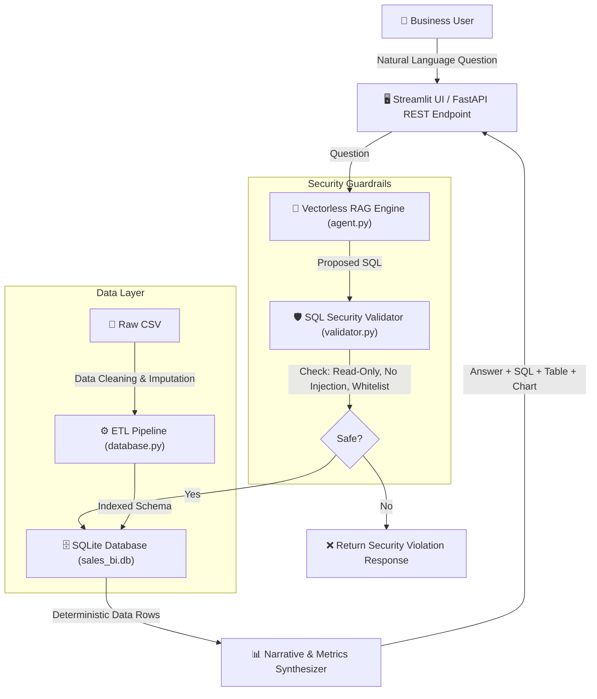

# Mini AI Business Intelligence Assistant (Vectorless RAG)

A production-grade, test-driven **Mini AI Business Intelligence Assistant** built for the **RSG Research Graduate Engineer Trainee (GET) Selection Challenge**.

The system enables business executives and analysts to query sales transactions using natural language and receive **deterministic, SQL-backed insights** with supporting figures, interactive visualizations, and strict security guardrails.

---

## 🌟 Key Features

1. **Vectorless RAG Architecture**:
   - Rather than converting tabular numbers into vector embeddings (which causes arithmetic hallucinations and aggregation failures), this system maps natural language into verified SQLite SQL queries.
   - **100% Deterministic Arithmetic**: Exact sums, averages, rankings, and month-over-month differences computed directly by the database engine.
2. **Robust Data Pipeline & Ingestion**:
   - Automated cleaning and type casting of CSV data.
   - **Imputation Strategy**: Imputes missing unit price in row `TXN0051` (Laptop Stand) to ₹1,200 using product median.
   - **ISO Date Normalization**: Standardizes `DD-MM-YYYY` to `YYYY-MM-DD` for native SQLite date functions.
   - **Business Metric Logic**: Disregards returned orders (`status = 'Returned'`) when computing realized net revenue.
3. **Multi-Layered Security Guardrails**:
   - Enforces read-only execution (`SELECT` / `WITH` only).
   - Rejects destructive operations (`DROP`, `DELETE`, `UPDATE`, `INSERT`, `ALTER`, `TRUNCATE`).
   - Blocks stacked queries and multi-statement SQL injections.
   - Validates table and column whitelist.
4. **Interactive Streamlit Dashboard**:
   - Executive KPI cards (Total Net Revenue, Completed Orders, Top Product, Peak Month).
   - 1-click preset buttons for the 5 challenge benchmark questions.
   - Interactive charts (trend lines, bar charts for product/regional performance).
   - Database Explorer to inspect and filter raw/cleaned records.
5. **FastAPI REST API**:
   - Clean microservice endpoints: `/api/query`, `/api/health`, `/api/summary`, and `/api/schema`.
   - Interactive Swagger API documentation at `/docs`.
6. **Automated Pytest Test Suite**:
   - 17 test cases covering data cleaning, all 5 benchmark questions, edge cases, SQL security injection defense, and API endpoints.

---

## 🏗️ System Architecture



---

## 📊 Benchmark Answers to the 5 Challenge Questions

All answers are verified against the cleaned dataset:

| # | Question | SQL Query | Result Summary |
|---|---|---|---|
| **1** | *What is the total revenue?* | `SELECT SUM(net_revenue) FROM sales_transactions WHERE status = 'Completed'` | **₹1,445,200.00** Net (Gross: ₹1,449,700, Discounts: ₹4,500 across 50 completed orders). |
| **2** | *Which product generated the highest revenue?* | `SELECT product, SUM(net_revenue) FROM sales_transactions WHERE status = 'Completed' GROUP BY product ORDER BY 2 DESC LIMIT 1` | **Monitor** with **₹473,000.00** (50 units sold in 9 orders). |
| **3** | *What is the monthly revenue trend?* | `SELECT strftime('%Y-%m', order_date), SUM(net_revenue) FROM sales_transactions WHERE status = 'Completed' GROUP BY 1 ORDER BY 1` | Jan: ₹210,250 • Feb: ₹234,600 • Mar: ₹223,900 • Apr: ₹240,700 • **May: ₹318,500 (Peak)** • Jun: ₹217,250. |
| **4** | *Which region generated the highest sales?* | `SELECT region, SUM(net_revenue) FROM sales_transactions WHERE status = 'Completed' GROUP BY region ORDER BY 2 DESC LIMIT 1` | **South Region** with **₹411,200.00** (28.45% of total revenue). |
| **5** | *How did revenue change between two months?* | Window function `LAG()` over monthly sales | Highest growth in **May 2026**: **+₹77,800.00 (+32.32%)** compared to April. |

---

## 🚀 Setup & Execution Instructions

### 1. Prerequisites
- Python 3.10+
- Pip package manager

### 2. Install Dependencies
```bash
pip install -r requirements.txt
```

### 3. Initialize the Database
```bash
python database.py
```
*Creates `sales_bi.db`, applies schema indexes, cleans missing records, and outputs key KPIs.*

---

## 🖥️ Running the Application

### Option A: Launch Interactive Streamlit UI
```bash
streamlit run app.py
```
Open your browser at `http://localhost:8501`.

### Option B: Launch FastAPI REST Server
```bash
uvicorn api:app --reload --port 8000
```
Open interactive Swagger documentation at `http://localhost:8000/docs`.

#### Test API Query via cURL:
```bash
curl -X POST "http://127.0.0.1:8000/api/query" \
     -H "Content-Type: application/json" \
     -d "{\"question\": \"What is the total revenue?\"}"
```

#### Expected API JSON Response:
```json
{
  "question": "What is the total revenue?",
  "status": "success",
  "answer": "The total net revenue generated from completed orders is ₹1,445,200.00. This is based on 50 completed transactions...",
  "sql_query": "SELECT SUM(gross_revenue) AS total_gross_revenue, SUM(discount_amount) AS total_discounts, SUM(net_revenue) AS total_net_revenue, COUNT(*) AS completed_transactions FROM sales_transactions WHERE status = 'Completed';",
  "data": [
    {
      "total_gross_revenue": 1449700.0,
      "total_discounts": 4500.0,
      "total_net_revenue": 1445200.0,
      "completed_transactions": 50
    }
  ],
  "columns": ["total_gross_revenue", "total_discounts", "total_net_revenue", "completed_transactions"],
  "row_count": 1,
  "latency_ms": 6.26
}
```

---

## 🧪 Running Automated Tests

Run the complete test suite:
```bash
python -m pytest test_assistant.py -v
```

All 17 tests validate:
- Ingestion and missing value imputation
- All 5 benchmark questions
- Edge case handling (Returned orders, 0 quantity)
- SQL injection guardrail defense (`DROP`, `DELETE`, `UPDATE`, stacked queries)
- Out-of-scope question handling
- FastAPI endpoint responses (`/api/health`, `/api/summary`, `/api/query`)

---

## 📂 Project Structure

```
├── ai_bi_assistant_sales_data - GET.csv  # Original sales dataset
├── sales_bi.db                           # Cleaned SQLite analytical database
├── database.py                           # ETL, data cleaning, schema, SQLite queries
├── validator.py                          # SQL security guardrails & injection defense
├── agent.py                              # Vectorless RAG engine & answer synthesizer
├── api.py                                # FastAPI REST service
├── app.py                                # Streamlit visual BI dashboard
├── test_assistant.py                     # 17 automated pytest test cases
├── requirements.txt                      # Project dependencies
├── README.md                             # Setup & execution guide
├── ARCHITECTURE.md                       # Architectural deep dive & Mermaid diagrams
└── AI_REFLECTION.md                      # AI tools usage report & GET interview prep sheet
```
# RSG_task
